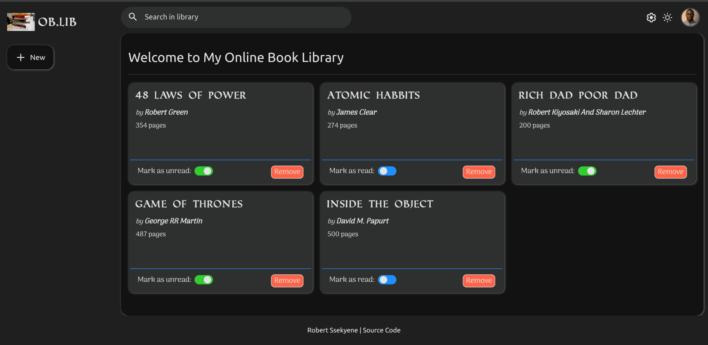

<h1 align="center">Online Book Library</h1>

  
  
  

  A simple web application to manage your personal book collection.

<a href="https://ssekyene.github.io/book-library/">Live Demo</a>

## Todos
- [ ] Implement responsive design for mobile devices.
- [ ] Implement local storage to save the library between sessions.
- [ ] Add search and filter functionality.
- [ ] Improve UI/UX with better styling and animations.
- [ ] Add pagination for large libraries.
- [x] Implement keyboard accessibility for all interactive elements.
- [x] Add confirmation dialog before removing a book.
- [ ] Enhance accessibilily for screen readers.

## Features
- Add, view, and remove books from your library.
- Toggle read status for each book.
- Theme switcher (light/dark mode).
- Form validation to ensure all fields are filled out correctly.
- Keyboard accessible controls for better usability.

## Technologies Used
- HTML5
- CSS3
- JavaScript (ES6+)

## Inspiration
This project was inspired by the need to implement the `Object and Object constructor` concepts in JavaScript, as well as to improve my skills in DOM manipulation and event handling.

## Acknowledgements
- Special thanks to [The Odin Project](https://www.theodinproject.com/) for their comprehensive curriculum and resources.
- [MDN Web Docs](https://developer.mozilla.org/) for comprehensive documentation and tutorials.
- [W3Schools](https://www.w3schools.com/) for additional learning resources